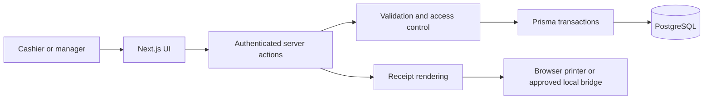

# Rice & Kottu Hut POS

**A complete, independently developed restaurant POS and back-office system for my own shop, Rice & Kottu Hut, by Kevin Menuja.**

A full-stack system developed for the day-to-day operations of Rice & Kottu Hut, bringing order entry, recorded payments, menu administration, staff access, expenses, reporting and thermal receipts into one application. The codebase supports a local workstation deployment and a separately configured cloud evaluation environment.

[View case study](docs/PORTFOLIO_CASE_STUDY.md) · [Browse demo media](docs/portfolio/README.md) · [Architecture](docs/ARCHITECTURE.md) · [Release evidence](docs/PORTFOLIO_RELEASE.md)

> **Project status: Complete — v1.1.0 released software.** The agreed single-restaurant scope is implemented and the owner reports that the shop installation works. The application is production-oriented, with documented quality, security, backup and operating procedures. Independent live-installation acceptance (including physical printer and recovery verification) is separate from software completion. The [Netlify evaluation site](https://rice-and-kottu-hut-pos.netlify.app/login) uses isolated synthetic data and requires authentication; it is not the shop database. No public administrator credentials are provided.

## Product preview


### Cashier workspace


| Tablet POS | Mobile POS |
| :---: | :---: |
|  |  |

[Order history](docs/portfolio/orders-desktop.jpg) · [Financial reports](docs/portfolio/reports-desktop.jpg) · [80 mm receipt preview](docs/portfolio/receipt-desktop.jpg) · [Recorded walkthrough](docs/portfolio/walkthrough.webm) · [Step-by-step walkthrough](docs/PORTFOLIO_WALKTHROUGH.md)

All screenshots and transactions shown in these assets use demonstration data.

## Capabilities

| Module | Implementation |
| --- | --- |
| **POS and orders** | Dine-in, takeaway and delivery; size/variant selection; server-priced checkout; order history, cancellation and invoice search |
| **Payment records** | Cash, card and QR tender selection, totals reconciliation and duplicate-submission protection |
| **Menu** | Category and product management, prices, availability and history-safe archival |
| **Dashboard** | Database-backed sales, payment mix, activity, expenses and best-seller summaries |
| **Reporting** | Sales, menu items, payments, cashiers and expenses; filtered CSV/Excel exports |
| **Staff and access** | Super Admin, Owner, Manager and Cashier roles; account management, activity records and session revocation |
| **Expenses** | Expense categories, access-controlled edits, filters, totals and audit history |
| **Receipts** | 80 mm browser-print layouts with stored invoice amounts and historical item-name snapshots |
| **Settings and recovery** | Restaurant, billing, receipt and printer preferences; private local PostgreSQL backups and documented recovery procedures |

**Payment boundary:** Card and QR are *recorded tender methods*, not card processing or bank-transfer verification. This application does not store card details or initiate transfers.

Customer profiles, table assignment, kitchen displays, inventory, supplier management and delivery marketplace integrations are outside the approved scope of this release.

## Technical architecture

| Layer | Technology |
| --- | --- |
| Interface | Next.js App Router, React 19, TypeScript, Tailwind CSS |
| Identity and authorization | Auth.js credentials, bcrypt, signed sessions and database-backed role/status checks |
| Backend | Next.js server components, server actions, Zod validation |
| Persistence | PostgreSQL, Prisma 7, transactional writes and unique checkout tokens |
| Cloud evaluation | Netlify Next.js runtime, Edge proxy, serverless handler and pooled Neon PostgreSQL |
| Workstation peripherals | 80 mm browser printing; optional authenticated local ESC/POS bridge |



See [Architecture and decisions](docs/ARCHITECTURE.md) for the trust boundaries, transaction guarantees and differences between cloud and local operation.

## Run locally

**Prerequisites:** Node.js 22, npm and PostgreSQL. PostgreSQL client utilities (`pg_dump`, `pg_restore`) are required for local database backups.

1. Clone the repository and install dependencies:
   ```bash
   git clone https://github.com/kevin-menuja/rice-and-kottu-hut-pos.git
   cd rice-and-kottu-hut-pos
   npm ci
   ```
2. Create a private local environment file from `.env.example`. Set a development `DATABASE_URL`, strong unique `AUTH_SECRET`, localhost `AUTH_URL` and `TRUSTED_ORIGIN`. Never use a customer database or production secret for development.
3. Generate Prisma and apply migrations to the **intended development database**:
   ```bash
   npx prisma generate
   npx prisma migrate deploy
   ```
4. Optionally seed **only a newly created disposable database** with a private `SEED_SUPER_ADMIN_PASSWORD`:
   ```bash
   npm run prisma:seed
   ```
5. Start the development server:
   ```bash
   npm run dev
   ```

Open `http://localhost:3000`. See [Setup](docs/SETUP.md) and [Database](docs/DATABASE.md) for installation and migration details. Seeding must never run against an existing restaurant database.

### Main environment variables

| Variable | Purpose |
| --- | --- |
| `DATABASE_URL`, `DATABASE_URL_UNPOOLED` | Pooled runtime database connection; optional direct migration connection |
| `AUTH_SECRET`, `AUTH_URL`, `TRUSTED_ORIGIN` | Session signing and trusted application origin |
| `NEXT_PUBLIC_APP_NAME`, `NEXT_PUBLIC_APP_VERSION` | Public application metadata |
| `SEED_SUPER_ADMIN_PASSWORD` | Initial credentials for a **new disposable** installation |
| `BACKUP_DIR` | Private workstation backup directory, outside the public web root |
| `POS_DEPLOYMENT` | Cloud/local behavior policy |
| `PRINTER_BRIDGE_URL`, `PRINTER_BRIDGE_TOKEN` | Optional local printer bridge; never expose across the public internet |

For the complete configuration and printer setup, use the [operations documentation](docs/README.md).

## Test and release process

```bash
npm run lint
npm run typecheck
npm test
npx prisma validate
npx prisma migrate status
```

The browser suite (`npm run test:e2e`) requires a **fresh isolated** PostgreSQL database named `startek_portfolio_<hex>`, synthetic seed credentials, a private backup directory and a local application server. It performs actual writes and must never target a customer database. See [Release verification](docs/PORTFOLIO_RELEASE.md) for the tested scenarios and recorded results.

[GitHub Actions workflow](.github/workflows/ci.yml) defines quality, cloud-build and disposable-database browser checks. The released application baseline at e5e8dc65 passed [hosted CI](https://github.com/kevin-menuja/rice-and-kottu-hut-pos/actions/runs/45502247679). Historical billing restrictions described in the release evidence are not the current CI status. The separate [production-readiness review (PR #7)](https://github.com/kevin-menuja/rice-and-kottu-hut-pos/pull/7) contains additional audited changes that are not part of the released baseline.

A Netlify deployment must be built from a clean checkout with credentials supplied as platform environment variables. The cloud build rejects local dotenv files. **For manual deployments, publish `.netlify/static` with the adapter functions, never `.next` alone.** Use [the verified deployment procedure](docs/DEPLOYMENT.md) and run `node scripts/smoke-netlify.mjs https://rice-and-kottu-hut-pos.netlify.app` to check the live stylesheet, restaurant logo, database health, and route protection. Apply migrations deliberately and inspect generated functions before uploading.

## Operating boundaries

- Cloud evaluation disables local filesystem backup/restore, local logo uploads, unattended printing, cash-drawer activation and direct printer bridge commands.
- Local printer, cutter and drawer support requires on-site acceptance and appropriate Windows/ESC-POS setup.
- A prior staging artifact exposure was remediated; historical provider access/retention and Windows credential-reuse disposition remain external security gates.
- [PR #1](https://github.com/Startek-pvt-ltd/startek-restaurant-pos/pull/1) was merged into `main`. The Netlify demonstration uses isolated synthetic records and is **not** the restaurant's production database. The project owner reports that the customer-site installation has passed functional verification; this is not independent on-site certification.
- Portfolio use of customer-identifiable branding requires appropriate client authorization. No customer sales records or privileged demo credentials are published.

## Documentation

Start with the [documentation index](docs/README.md). Key references include the [architecture](docs/ARCHITECTURE.md), [portfolio case study](docs/PORTFOLIO_CASE_STUDY.md), [verification matrix](docs/PORTFOLIO_RELEASE.md), [printer acceptance checklist](docs/PRINTER_ACCEPTANCE_CHECKLIST.md), [backup procedure](docs/BACKUP_RESTORE_GUIDE.md) and [security policy](SECURITY.md).

---

Developed by **Kevin Menuja** for Rice & Kottu Hut, with Startek attribution retained in historical engineering records. This repository documents the completed scoped software and its demonstrated behavior; it does not assert independent physical production certification.
